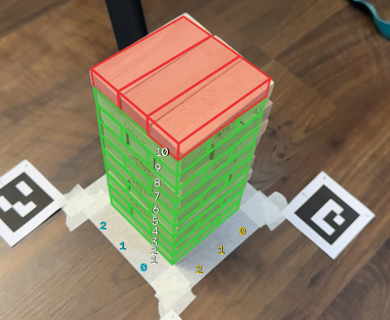

# Jenga tower tracker (LiDAR + camera) — work in progress

An iPhone with LiDAR (and optionally a second, ordinary phone) watches a Jenga tower, works out which
blocks are present, and shows **green / red** on each block: green = may be pulled, red = may not.

> **Status: experimental.** The pipeline works end to end and the geometry is solid, but reliably
> telling *which block was pulled* from camera + LiDAR is not solved yet (see "What works").



## What works / what doesn't
| Works | Not yet |
|---|---|
| iPhone app streams RGB + LiDAR depth + confidence + pose to the Mac | Reliable per-block present / missing detection |
| ArUco marker mat gives a fixed tower frame; LiDAR agrees with it (desk plane within ~1 mm, ~3 mm noise) | Using the Android view for detection (it only draws the overlay) |
| Live viewer with both cameras side by side, red/green overlay, rules ("only below the highest complete layer; the layer must stay standing") | Learned model (dataset + extractor are in place, training is next) |
| Collapse detection; Mac-side START / STOP / MARK so nobody touches the phone | |
| Face-crop dataset builder for training | |

## Hardware
* iPhone with LiDAR (tested on a 15 Pro) running the app in `lidar-capture/` (Xcode, UIKit + ARKit)
* Optional second camera: any phone with a browser (served over HTTPS by the Mac)
* 4 printed ArUco markers (`aruco_markers_A4.png`: DICT_4X4_50, ids 0-3, **40 mm**), taped in a square ring
  (ids run around the square; set the half-spacing in `tower_points.py` / env `MARKER_HALF`, currently 80 mm = ~160 mm apart), tower centred between them. Phones on stands, ~45 cm away.

## Quick start
```bash
scripts/setup.sh                      # venv + dependencies + fetches STEPWISE into third_party/
.venv/bin/python iphone_saved.py      # server: prints your Mac's IP
```
1. Open `lidar-capture.xcodeproj` in Xcode, choose **your own signing team**, run on the iPhone, type the Mac's IP.
2. Open `http://localhost:8000/` — live view and controls (START / STOP / MARK with the space bar).
3. Android / second camera: open `https://<mac-ip>:8443/cam` in Chrome, accept the certificate warning.
   Calibrate its lens once: `.venv/bin/python calibrate_camera.py --show-board`, then
   `.venv/bin/python calibrate_camera.py --url http://127.0.0.1:8000/android_raw.jpg`.
4. **Training data:** the *Start data capture* button records both cameras and cuts out every visible block face.

## Layout
| File | Purpose |
|---|---|
| `iphone_saved.py` | Upload server + live viewer + overlay + live tracker + data capture |
| `lidar-capture/` | iOS app (capture, preview stream, remote START/STOP/MARK) |
| `tower_points.py` | Marker layout, pose solver, LiDAR-into-tower-frame check |
| `game_events.py`, `live_tracker.py` | Per-slot reader and move detector (offline and live) |
| `rgb_cue.py`, `stepwise_adapter.py` | Colour cue; adapter into STEPWISE's depth reader |
| `face_crops.py`, `extract_crops.py` | Face-crop dataset (`dataset/`, not in the repo) |
| `calibrate_camera.py`, `android_cam.py` | Second-camera lens calibration / app-free capture |
| `fuse_scan.py`, `tsdf_fuse.py`, `refined_fuse.py`, `process_scan.py` | Early mesh-reconstruction experiments (superseded) |

## Notes
* Recordings and the dataset are deliberately not in this repo (large; they show people). `docs/` has tower-only figures.
* Tower orientation matters: the marker frame is turned so the bottom layer runs along x
  (`tower_points.py`, `LAYOUTS["A"]`). A different build orientation needs that one table changed.
* Depth reader and tower geometry come from **STEPWISE / ThirdEye** by Aadit Pani
  (https://github.com/AaditPani-RVU/STEPWISE), fetched by the setup script, not copied here.
