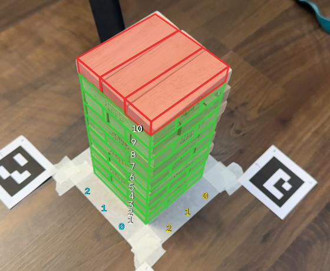
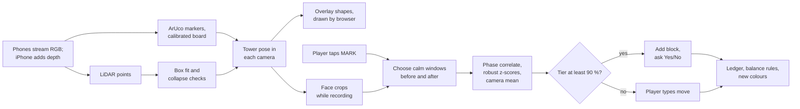
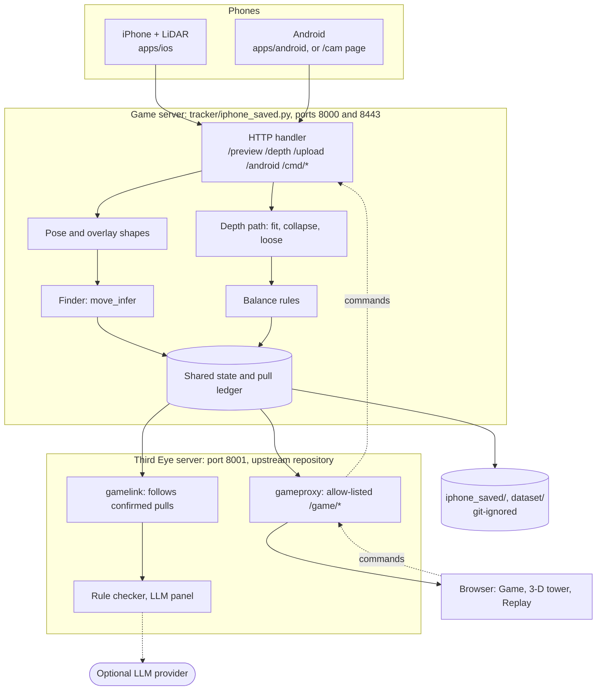
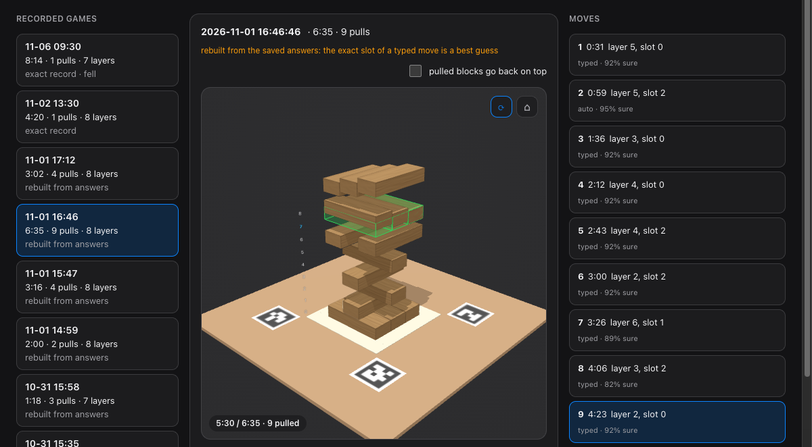

# Third Eye

**A phone-based referee for physical Jenga: it shows which blocks may be pulled, names the block that was pulled, and flags a collapse.**




> **Experimental.** It works end to end on one tower and one desk setup, with a player in the loop. Results come from a small number of games and none is held out. See [Evaluation and results](#evaluation-and-results).

**Contents:** [Overview](#overview) · [Key features](#key-features) · [How it works](#how-it-works) · [Architecture](#architecture) · [Tech stack](#technology-stack) · [Repository](#repository-structure) · [Setup](#installation-and-setup) · [Configuration](#configuration) · [Usage](#usage) · [Evaluation](#evaluation-and-results) · [Limitations](#limitations) · [Future work](#future-work) · [Docs](#documentation) · [Contributors](#contributors) · [License](#license-status)

---

## Overview

An iPhone with LiDAR, and optionally a second phone, watches a Jenga tower standing on a printed marker board. A Python server on a Mac places a model of the tower in each camera view and colours every block live. After each move, it compares the tower before and after to find the block that was pulled, and asks the player to confirm or type the answer.

**The problem.** A referee for a physical game needs the state of the pieces and the rules. Jenga layers are only 15 mm tall and look alike, while [published work](https://doi.org/10.1038/s41598-021-01763-9) puts phone LiDAR at about ±1 cm on objects over 10 cm, so the state cannot simply be read from the depth sensor. Third Eye combines a fixed board, before-and-after image comparison, an explicit balance model, and a human confirmation step.

## Key features

| Feature | How it works | Evidence |
|---|---|---|
| **Green / red / amber blocks** | Balance rules in `jenga_rules.py`; amber marks an allowed block that looks loose | Rules: hand-worked unit tests. Amber: only injected offsets, never a real loose block |
| **Which block was pulled** | `move_infer.py` compares face crops before and after a MARK tap | 25/32 exact layer, offline, with optimistic labels |
| **Confirm or type** | At 90 % tier or above the block is added and the player answers Yes/No; below that the player types the move | Design choice; tiers are in-sample lookups, not calibrated probabilities |
| **Collapse detection** | Two LiDAR checks with guards against false alarms | One real fall in three replays; very weak evidence |
| **Height reading** | LiDAR box fit, height / 15 mm | A simple percentile beat the fit on clean frames |
| **Replay and 3-D view** | Every change is logged to `moves.jsonl`; the Third Eye UI rebuilds the game | Observed in use |
| **Wi-Fi or USB cable** | Relays for each phone; falls back to Wi-Fi | Wired frame rates were not measured |

## How it works



1. **Pose.** Four 40 mm ArUco markers give the tower's pose. With four markers the server uses IPPE; with three it uses SQPnP plus 24 seeded solves, because three points are ambiguous from a low camera.
2. **Hand presence.** The game server uses **frame differencing** over the tower region (`MOTION_FRAC`), not a hand-tracking model. Judging pauses while something large moves there.
3. **Pull finding.** For each face seen before and after a move, the after-image is aligned by phase correlation and the remaining difference becomes a robust z-score. A block's score is the **unweighted mean** of the two cameras' best faces.
4. **Rules.** After a hypothetical pull, the centre of mass above every layer must stay over that layer's remaining blocks, with a 4 mm margin. Blocks at or above the top complete layer stay put, and a house rule protects the bottom layer.
5. **Collapse.** A height watch and a standing check each need the highest points to have dropped at least 30 mm. A covered lens counts as "cannot see", not as a fall.

<details>
<summary><b>The balance rule, worked for one layer of a straight tower</b></summary>

| Blocks left in the layer | What may go | Why |
|---|---|---|
| Left, middle, right | Any | The remaining two still span the centre |
| Left, middle (or middle, right) | The edge block only | Middle alone spans the centre; an edge block alone does not |
| Left, right | Neither | One edge block cannot carry the weight above |
| Middle | Nothing | It is the last block, and a layer is never emptied |

The model assumes equal block weights and no friction. `BOTTOM_LAYER_LEGAL` in `tracker/jenga_rules.py` switches the house rule.
</details>

## Architecture



The `tracker/` server has its own viewer at `http://localhost:8000/`. The fuller web UI, rule checker, rule compiler and LLM panel are in [Aadit Pani's Third Eye repository](https://github.com/AaditPani-RVU/ThirdEye), which `scripts/setup.sh` fetches into `third_party/STEPWISE`.

## Technology stack

| Part | Technology |
|---|---|
| Game server | Python, standard-library HTTP server, OpenCV (ArUco, PnP, phase correlation), NumPy, Matplotlib |
| iPhone app | Swift, UIKit, ARKit (scene depth) |
| Android app | Kotlin, Gradle |
| Upstream UI and rules | Python, FastAPI, pydantic; React and TypeScript web UI |
| Calibration | Zhang-style lens calibration, bundle-adjusted marker board |
| Paper | LaTeX with IEEEtran, TikZ and pgfplots |

## Repository structure

```text
ThirdEye/
├── README.md
├── requirements.txt          Python dependencies for the game server
├── camera_android.json       Example lens calibration, specific to one phone
├── apps/
│   ├── android/              Kotlin capture app (Gradle project)
│   └── ios/
│       ├── lidar-capture/              Swift capture app source
│       └── lidar-capture.xcodeproj/    Xcode project
├── benchmarks/
│   ├── benchmark_height.py   Height baselines (needs recordings)
│   ├── benchmark_pose.py     Pose comparison (needs recordings)
│   ├── finder_variants/      Finder evaluation scripts, stored per-pull scores, RESULTS.md
│   └── logs/                 Benchmark output transcribed from a terminal (not original logs)
├── docs/
│   ├── analysis/             Quantitative and qualitative analysis notes
│   ├── figures/              Overlay, crop and orientation images
│   ├── hardware/             Printable ArUco marker sheet
│   ├── paper/                Papers (LaTeX, PDF) and two paper figures
│   └── presentation/         Slides (PDF)
├── experiments/              Early mesh and unlabelled-data experiments (superseded)
├── patches/                  Game console changes for the upstream UI
├── scripts/                  Setup, start-up and wired-mode helpers
├── tests/                    Rule, fit and replay checks
├── tools/                    Calibration, crop extraction, label scoring, coverage advice
└── tracker/                  Game server and every module it imports
```

`tracker/`, `scripts/`, `patches/`, `requirements.txt` and `camera_android.json` are at fixed locations that the code depends on. Keep `tracker/` one level below the root.

<details>
<summary><b>What each main module does</b></summary>

| File | Purpose |
|---|---|
| `tracker/iphone_saved.py` | Server, viewer, overlay, hand gate, data capture, finder jobs, collapse and loose-block watch |
| `tracker/jenga_rules.py` | Green/red rules and the effective tower after placements |
| `tracker/move_infer.py` | Deployed finder and confidence tiers |
| `tracker/tower_points.py` | Marker layout, pose solver, frame correction |
| `tracker/tower_fit.py`, `tracker/tower_edges.py` | LiDAR box fit; edge snapping per camera |
| `tracker/tower_auto.py`, `tracker/calibrate_markers.py` | Layer count from two cameras; per-game marker measurement |
| `tracker/depth_protrusion.py` | LiDAR points and face offsets |
| `tracker/face_crops.py`, `tracker/crop_worker.py` | Face-crop dataset |
| `tracker/game_events.py`, `tracker/live_tracker.py`, `tracker/rgb_cue.py`, `tracker/stepwise_adapter.py` | Earlier per-slot reader and tracker; need `third_party/`; not in the deployed path |
| `tools/calibrate_camera.py`, `tools/calibrate_board.py` | Lens calibration; one-time marker-board calibration |
| `tools/label_eval.py`, `tools/extract_crops.py`, `tools/cluster_crops.py`, `tools/camera_coverage.py`, `tools/android_cam.py` | Label scoring, crop extraction, clustering, view advice, app-free capture |
</details>

## Installation and setup

> **Verification status.** The full setup needs a Mac and two phones, so these commands were checked against the code but not run end to end during this documentation pass. On Windows, the server started and served its pages from this layout, and it needed `PYTHONIOENCODING=utf-8` and OpenSSL available. The Xcode and Gradle projects were moved as whole folders and have not been rebuilt since.

**You need:**

- A Mac on the same network as the phones (the helper scripts assume macOS paths and tools).
- An iPhone with LiDAR. A 15 Pro was tested.
- Optionally, an Android phone, on a stand on the opposite side.
- The four markers from [`docs/hardware/aruco_markers_A4.png`](docs/hardware/aruco_markers_A4.png): `DICT_4X4_50`, ids 0–3, 40 mm, in a ring around the tower. Each phone should see at least three, from about 45 cm.

**1. Server**

```bash
scripts/setup.sh                          # venv, dependencies, fetches upstream into third_party/
.venv/bin/python tracker/iphone_saved.py  # prints this Mac's IP; viewer on http://localhost:8000/
```

**2. iPhone app.** Open `apps/ios/lidar-capture.xcodeproj` in Xcode, choose your own signing team, run it on the phone, and type the Mac's IP.

**3. Android app (optional).** Needs JDK 17+ and the Android SDK.

```bash
cd apps/android && ./gradlew assembleDebug
adb install -r app/build/outputs/apk/debug/app-debug.apk
```

The browser page `https://<mac-ip>:8443/cam` also works, after accepting the self-signed certificate warning.

**4. Calibration.** The shipped `camera_android.json` is for one specific phone, so replace it with your own:

```bash
.venv/bin/python tools/calibrate_camera.py --show-board
.venv/bin/python tools/calibrate_camera.py --url http://127.0.0.1:8000/android_raw.jpg
.venv/bin/python tools/calibrate_board.py       # once, for a permanently fixed board; writes marker_map.json
```

For a board that isn't fixed, use `.venv/bin/python tracker/calibrate_markers.py` instead. Without a `marker_map.json` the nominal layout is used.

**5. Third Eye UI (optional).**

```bash
scripts/start_all.sh   # game server on :8000, UI on http://localhost:8001/#/game
```

> **Known setup issue.** `scripts/setup.sh` checks out upstream branch `jenga-real-data-eval`, but `patches/thirdeye-game-console.patch` does not apply to it at the current upstream commit, and the script's `|| true` hides the failure. A fresh install may therefore have no Game tab. The Game tab code exists on upstream branch `mitul/game-console`, which is a possible workaround that hasn't been tested here.

## Configuration

Environment variables read by the server and modules:

| Variable | Default | Effect |
|---|---|---|
| `LIDAR_PORT` | `8000` | HTTP port |
| `LIDAR_HTTPS_PORT` | `8443` | HTTPS port for the browser camera page |
| `LIDAR_SAVE_DIR` | `iphone_saved/` | Where frames are saved |
| `MARKER_HALF` | `80` | Half the marker spacing, in mm, when there is no marker map |
| `MARKER_MAP` | on | `off` ignores `marker_map.json` |
| `POSE_EMA` | `0.2` | Share of each new pose taken while a phone is still |
| `ANALYSIS_FPS` | `10` | Most overlay updates per second, per phone |
| `ANDROID_SAVE_FPS` | `3` | Android frames saved per second while recording |

Upstream LLM features read a key from `third_party/STEPWISE/.env`, for example `GROQ_API_KEY=...`.

## Usage

**Playing a game**

1. Build the tower. In the **Tower** panel, type the number of layers and press Apply. **Re-detect** can measure it, but may fail on very tall towers.
2. Switch on **Training data**: the finder needs the crops it records.
3. Press **START**, then pull a block.
4. When your hand is clear, press **MARK**. The system waits for a calm view.
5. If it is sure enough (at least 90 %), it adds the block and asks **Yes/No**. Otherwise, type the column and layer, for example `l 5`.
6. Colours update: **green** may be pulled, **amber** may be pulled but looks loose, **red** may not. **NO MOVES LEFT** and **GAME OVER** banners appear on their own.
7. For a new game, use the **New game** control, or clear the *removed* box and press Apply.

Typing `fell` in the label box also declares a collapse.

**Example workflow**

```text
Tower panel: layers = 8, Apply      → all 8 layers drawn, colours shown
Training data: on, START            → frames and crops being recorded
Pull a block, then MARK             → "layer 5, left column - 95% sure. Added to the tower."
Yes                                 → logged as confirmed; 3-D view updated
Next pull, MARK                     → "Best guess layer 3 - only 50% sure, so nothing was changed."
Type: r 3                           → block marked removed; colours update
```

The messages above are illustrative of the wording used in `tracker/iphone_saved.py`.

<details>
<summary><b>Wired mode (USB instead of Wi-Fi)</b></summary>

- **iPhone.** The app queues requests on port 8765 and `scripts/usb_bridge.py` collects them through `iproxy`. Install with `brew install libimobiledevice`, then run `.venv/bin/python scripts/usb_bridge.py`.
- **Android.** `scripts/wired.sh` runs `adb reverse tcp:8000 tcp:8000`, and the app switches by itself. Re-run it after replugging.
- **Both.** `scripts/wired_auto.sh` handles both phones hands-off.

The apps return to Wi-Fi if the cable goes away. Wired frame rates were not measured.
</details>

**Tests**

```bash
.venv/bin/python tests/test_jenga_rules.py   # no data needed
.venv/bin/python tests/test_tower_fit.py     # no data needed
```

| Test | Needs |
|---|---|
| `tests/test_game_events.py` | `third_party/STEPWISE` from setup |
| `tests/test_height_replay.py`, `tests/test_loose_replay.py` | Private recordings, and run arguments |

These are scripts rather than pytest tests, so `pytest tests` reports collection errors.

## Evaluation and results

These figures come from a small, single-setup case study. **None is held out**, and constants were tuned on the same sessions. Full methods are in the [paper source](docs/paper/third_eye_paper_v2.tex).

| Question | Result | How to read it |
|---|---|---|
| **Finder, offline** | **25/32 exact layer** (78 %, Wilson 95 % 61–89 %); 30/32 within one, 11 games | Offline evaluation of the deployed scoring, not live end-to-end accuracy. A confident answer nobody corrected counts as correct, so this is optimistic |
| Finder, earlier snapshot | 24/31 exact (77 %), 10 games | The same data without one game. No experimental reason for its absence is recorded |
| Product rule | 26/32 | Exists only in an offline script, chosen after seeing the data. Not deployed and not validated |
| **Cameras** | Inconclusive | On these sets iPhone leads (24/30 vs 17/31). An older 57-pull set had Android ahead, 59 % to 49 %, for unknown reasons |
| **Overlay** | LiDAR fit did not beat markers alone: 2.95 vs 3.07, 75 frames | An edge-strength proxy, not a position error. Snapping scores higher, but it optimises that same score |
| **Height** | 98th percentile 98 % exact vs box fit 88 %, 233 frames from 3 towers | Hand-free frames. In a synthetic hand test the box fits had lower error than the percentile |
| **Collapse, current detector** | One real fall detected; no false alarm in two other games | One event. Guards were designed on similar sessions, and the lens case was only simulated |
| **Tall towers** | Not established | Three results under different conditions: 10/13 in the offline set; 1/7 replaying pre-calibration recordings; 9/9 in one game on 25 October with an older finder. They are not combined |

Older figures in earlier versions of this README (3/3 collapses, 25 October, older height-only detector; and the 9/9 tall-tower game) were different experiments and don't describe the current system.

**Data provenance.** `benchmarks/finder_variants/variant_scores.json` is stored script output. `benchmarks/logs/*.txt` are **transcribed** from a terminal, not original logs. Stage timings, including the 62 ms box fit, came from another machine with no log, so they aren't headline results. Recordings (`dataset/`, `iphone_saved/`) show identifiable people and rooms and are deliberately not published, so the benchmarks can't be re-run from this repository alone.

> **Warning.** Running `benchmarks/finder_variants/eval_variants.py` without the private `dataset/` folder overwrites `variant_scores.json` with empty results. If that happens, restore the file with `git restore benchmarks/finder_variants/variant_scores.json`.

## Limitations

**System**

- Needs a printed board, phones on stands and a recording running; the helper scripts assume a Mac.
- Placements are assumed, not observed. More than one block removed in a turn goes undetected unless the top drops.
- The balance model assumes a straight tower, equal block weights and no friction.
- Depth comes from the iPhone only, and it sees only some faces from a steep angle.
- Frame differencing detects motion, not hands, and any large change near the tower counts.
- Depth exceptions are caught and lost silently, and poses are held for up to 6 s without markers.
- The loose-block warning has never been tested on a real loose block.

**Evaluation**

- Few games, one tower, one board, one lighting setup, the authors as players.
- Labels are optimistic, and pulls within a game are correlated.
- End-to-end latency, millimetre overlay error and wired frame rates were not measured.

**Known code issues**

- `benchmarks/benchmark_height.py` fails with a missing `time` import.
- See the setup note about the Game tab patch.

## Future work

- A held-out test with frozen settings and independent ground truth, such as video review of each pull.
- Overlay error in millimetres against hand-clicked tower corners.
- Counts of each label type, and a resolution of the 57-pull camera disagreement.
- Logged MARK-to-answer time and wired-versus-Wi-Fi frame rates.
- More recorded falls, a real hand over the lens, and a real loose block.
- A measurement of how the Yes/No prompt affects players.

## Documentation

| Document | Contents |
|---|---|
| [`docs/paper/third_eye_paper_v2.tex`](docs/paper/third_eye_paper_v2.tex) | Main paper: design, methods, results, threats to validity |
| [`docs/paper/CS3235_paper.tex`](docs/paper/CS3235_paper.tex), [`CS3235_TeamNo_ThirdEye.pdf`](docs/paper/CS3235_TeamNo_ThirdEye.pdf) | Earlier course paper |
| [`docs/presentation/Third_Eye_Presentation.pdf`](docs/presentation/Third_Eye_Presentation.pdf) | Slides |
| [`docs/analysis/quantitative_analysis.md`](docs/analysis/quantitative_analysis.md) | Numbers and intervals |
| [`docs/analysis/qualitative_analysis.md`](docs/analysis/qualitative_analysis.md) | Failure modes and interpretation |
| [`benchmarks/finder_variants/RESULTS.md`](benchmarks/finder_variants/RESULTS.md) | Finder comparison across label sets |



*Replay of a recorded 8-layer game in the Third Eye UI.*

## Contributors

| | Profile |
|---|---|
| **Aadit Pani** | [github.com/AaditPani-RVU](https://github.com/AaditPani-RVU/) |
| **Megh Mavani** | [github.com/meghmavani](https://github.com/meghmavani) |
| **Mitul K M** | [github.com/switchtwitch12345](https://github.com/switchtwitch12345/) |

## Acknowledgements

The depth reader, tower geometry, rule checker and upstream web UI come from [Aadit Pani's Third Eye repository](https://github.com/AaditPani-RVU/ThirdEye), fetched at setup rather than copied here. This work was carried out at RV University, Bengaluru.

## License status

This repository has **no license file**, so no open-source license has been granted. Contact the contributors before reusing the code.
